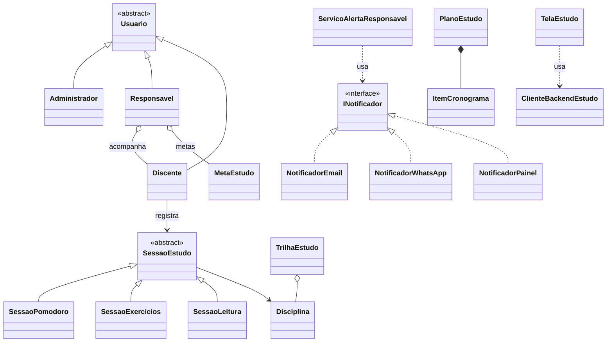

<div align="center">

# 📚 Plataforma de Apoio ao Estudo

**Mini-Projeto PI · Front-end em JavaScript integrado a um backend C# + MySQL**

</div>

---

## 📑 Sumário

- [✨ Sobre o projeto](#-sobre-o-projeto)
- [🗂️ Estrutura](#️-estrutura)
- [🚀 Como executar](#-como-executar)
- [🎯 Mapa das missões](#-mapa-das-missões)
- [🧬 Diagrama de classes](#-diagrama-de-classes)
- [🔌 Rotas do backend](#-rotas-do-backend)
- [🛠️ Problemas comuns](#️-problemas-comuns)

---

## ✨ Sobre o projeto

Uma tela de acompanhamento de estudos em **JavaScript puro** (sem frameworks), construída aplicando os conceitos de **Programação Orientada a Objetos** das Missões 1 a 10. O estudante registra sessões de estudo, ganha **XP**, acompanha a **meta semanal** e o responsável pode ser **notificado**. Tudo conversa com o backend C# e o banco MySQL.

| | |
|---|---|
| 🎓 **Discente de teste** | Lucas Silva |
| 👨‍👧 **Responsável de teste** | Carlos Silva |
| 🎯 **Meta semanal** | 180 minutos |
| ⏱️ **Duração por sessão** | de 1 a 480 minutos |

### 🧮 Fórmulas de XP

| Modalidade | Cálculo |
|---|---|
| 🍅 **Pomodoro** | `duração × 2 + ciclos × 15` |
| 📝 **Exercícios** | `duração + acertos × 10` |
| 📖 **Leitura** | `duração + páginas × 3` (+25 se fez resumo) |

---

## 🗂️ Estrutura

```text
MiniProjetoPI/
├── index.html   → estrutura da tela
├── estilo.css   → visual e responsividade (celular e telas grandes)
├── app.js       → classes (Missões 1–8), tela (Missão 9) e cliente do backend (Missão 10)
└── README.md    → este arquivo
```

---

## 🚀 Como executar

### 🖥️ Com o backend (integração real)

1. Extraia o `Backend.zip` e dê duplo-clique em **`iniciar_backend.bat`** (Windows). O servidor sobe em `http://localhost:5080`; deixe a janela preta aberta.
   - 🐬 Com MySQL ligado, os dados são gravados no banco. Sem MySQL, o backend usa um arquivo JSON local com as mesmas rotas.
   - 🔑 Se o MySQL tiver senha, ajuste o `mysql_config.txt` da pasta `Backend`.
2. Abra o **`index.html`** no navegador. O selo no topo deve ficar **verde** (_Backend online_).
3. Escolha a disciplina e a modalidade, informe a duração e clique em **Registrar Estudo**.
4. Use **Carregar Histórico do Servidor / Relatório** para ver o que foi gravado.

### 🌐 Sem o backend (GitHub Pages)

O GitHub hospeda apenas a tela; o backend roda no computador de quem o inicia. Se a página não encontrar o servidor, ela entra em **modo local** (selo **amarelo**): sessões, XP, meta e relatório ficam salvos no `localStorage` do navegador, usando as mesmas rotas simuladas.

**Para publicar:**

1. Envie `index.html`, `app.js`, `estilo.css` e `README.md` para a **raiz** do repositório.
2. Vá em **Settings → Pages → Deploy from branch → `main` / `(root)`**.
3. Aguarde 1 a 2 minutos e acesse `https://seu-usuario.github.io/nome-do-repo/`.

---

## 🎯 Mapa das missões

| # | Conceito | Onde está no `app.js` |
|:-:|---|---|
| 1 | Abstração, classes e objetos | `Disciplina` |
| 2 | Encapsulamento (campos `#privados`, validações) | `MetaEstudo` |
| 3 | Classe abstrata e herança | `Usuario` → `Administrador`, `Responsavel`, `Discente` |
| 4 | Polimorfismo dinâmico | `SessaoEstudo` → `SessaoPomodoro`, `SessaoExercicios`, `SessaoLeitura` |
| 5 | Sobrecarga simulada (3 formas de chamada) | `Discente.registrarEstudo()` |
| 6 | Interfaces (contratos por _duck typing_) | `INotificador` (`NotificadorEmail`, `NotificadorWhatsApp`, `NotificadorPainel`) e `IExportavelJson` (`paraJson()`) |
| 7 | Associação e agregação | `Responsavel` ↔ `Discente`/`MetaEstudo`, `TrilhaEstudo` |
| 8 | Composição e dependência | `PlanoEstudo` + `ItemCronograma`, `ServicoAlertaResponsavel` |
| 9 | Interface com o usuário | `TelaEstudo` (só lê os campos e delega aos objetos) |
| 10 | Integração com o backend | `ClienteBackendEstudo` |

---

## 🧬 Diagrama de classes



---

## 🔌 Rotas do backend

| Método | Rota | Para quê |
|:-:|---|---|
| `GET` | `/api/status` | Verificar se o backend está no ar e o modo de banco |
| `GET` | `/api/sessoes?discente=` | Histórico de sessões gravadas |
| `POST` | `/api/sessoes` | Gravar uma nova sessão (corpo gerado por `paraJson()`) |
| `GET` | `/api/metas?discente=` | Meta semanal e minutos cumpridos |
| `GET` | `/api/relatorio/{nome}` | Totais de sessões, minutos, XP e % da meta |

---

## 🛠️ Problemas comuns

<details>
<summary>🔴 Selo vermelho "Backend offline"</summary>

A janela preta do `iniciar_backend.bat` está fechada ou não abriu. Abra-a de novo e recarregue o `index.html` com **F5**.
</details>

<details>
<summary>🟡 Selo amarelo "Modo local"</summary>

É esperado quando o backend não está ligado (por exemplo, no GitHub Pages). Tudo funciona, mas os dados ficam só no navegador.
</details>

<details>
<summary>🍎 Safari não conecta ao backend a partir do GitHub Pages</summary>

O Safari bloqueia o acesso de páginas `https` ao `localhost`. Abra o `index.html` direto no computador, com o backend ligado.
</details>

<details>
<summary>🪟 A janela preta fecha sozinha</summary>

Abra o `cmd` dentro da pasta `Backend` e rode `BackendEstudoAPI.exe` para ver a mensagem de erro.
</details>

---

<div align="center">

Feito com 💚 para o Projeto Interdisciplinar

</div>
